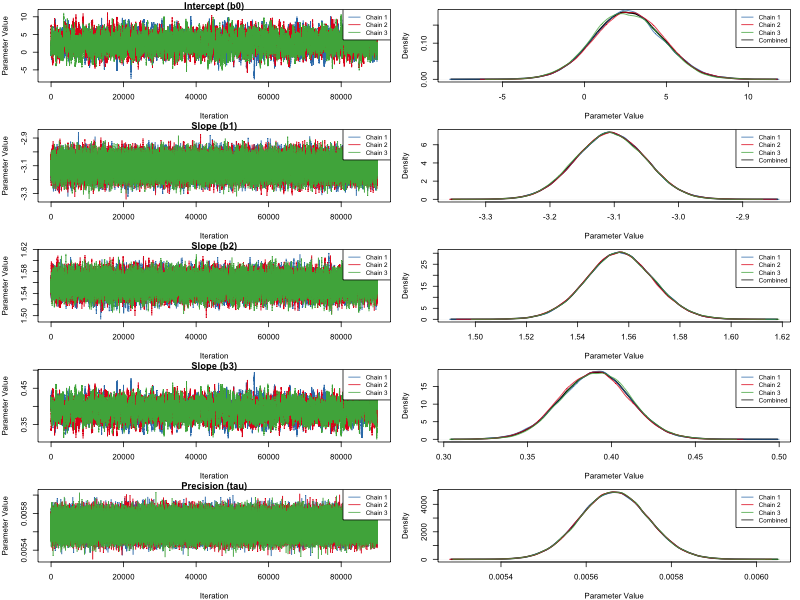
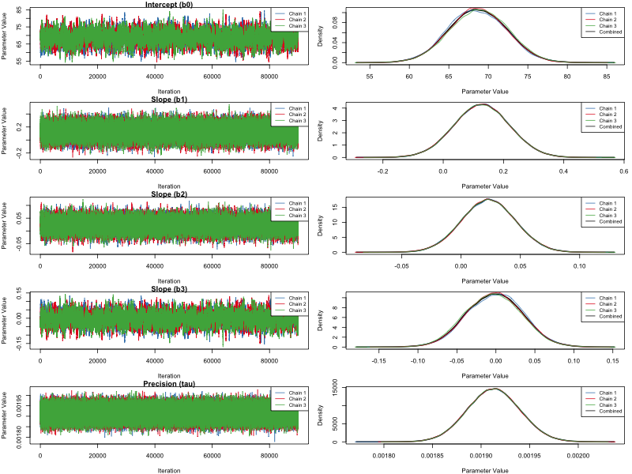

::: {.project}
# Exact standard errors for FOCE/FOCEI

Together with Mélissa Beldjenna, Matthew Fidler, Laura Zwep and Coen van Hasselt, I derived closed-form third-order sensitivity equations for the FOCE and FOCEI population likelihood. This gives the exact observed information, and therefore exact standard errors, without step-size dependent finite differencing. The method is implemented in `nlmixr2`. Read the preprint on [bioRxiv](https://www.biorxiv.org/content/10.64898/2026.07.09.737434v1): *From exact gradients to exact standard errors: third-order sensitivity equations for the FOCE and FOCEI population likelihood*.
:::

::: {.project}
# admixr2 package

Pharmacometric modelling is traditionally performed using individual level data. Recently a new method was developed to fit pharmacometric models to summary level – or aggregate – data. This methodology allows for jointly modelling different data sources, once transformed into aggregate data. In this study we aimed to (1) implement this methodological framework into an accessible R package (`admixr2`, formerly `admr`) and (2) develop a novel algorithm with enhanced computational efficiency. The package allows calculating aggregate data from different data sources, jointly fitting one or multiple data sources and assessing model performance. The newly developed algorithm improves computational efficiency by iteratively reweighting internal Monte Carlo predictions. Three simulation scenarios using different data generating models demonstrated a 3 to 100-fold speed-up when using the novel Iterative Reweighting Monte Carlo (IR-MC) algorithm, while maintaining the convergence properties of the original MC algorithm. The IR-MC algorithm becomes increasingly efficient as model complexity rises, indicating its utility for more complex pharmacometric models.

The work is published in the *Journal of Pharmacokinetics and Pharmacodynamics* ([doi:10.1007/s10928-025-10011-w](https://doi.org/10.1007/s10928-025-10011-w)); a preprint is available on [bioRxiv](https://www.biorxiv.org/content/10.1101/2025.10.28.685047v1).
The package can be found on [GitHub](https://github.com/LeidenPharmacology/admixr2) and on [CRAN](https://cran.r-project.org/package=admixr2), with documentation at the [package website](https://leidenpharmacology.github.io/admixr2/).
:::

::: {.project}
# Open-source development: nlmixr2 and ferx

I am a developer of the open-source pharmacometrics tools [`nlmixr2`](https://nlmixr2.org/) (R, nonlinear mixed-effects modelling) and [`ferx`](https://github.com/FeRx-NLME/ferx-core), an NLME engine for population PK/PD with FOCEI, SAEM, analytical PK and ODE models.
:::

::: {.project}
# Bayesian Statistics

In this project for the course Bayesian Statistics by Prof. dr. Herbert Hoijtink, the main goal was to develop a Gibbs sampler for a Bayesian linear regression model. By using two simulated data set the Gibbs sampler was tested and the results were compared. The Gibbs sampler was then applied to a real data set to identify the key factors that play a role in the University admittance process, using a open source data set. We used non-informative conjugate priors, as specified in the info note underneath. Next to this Bayesian Model Averaging was used to identify the most important variables in the model. The project was university coursework and was rewarded a 10.0/10.0 grade. The closed-form Bayesian engine (the Gibbs sampler and its derived conditional distributions) was written by hand, without AI-assisted coding. The project can be found [here](Bayes.pdf).

::: {.callout-note collapse="true"}
**Theorem**\
$Y_i = b_0 + b_1x_{1i} + b_2x_{2i} + b_3x_{3i} + e_i$ with $e_i$ i.i.d. $\sim N(0,1/\tau)$ and priors\
$b_0 ... b_3 \sim N(0,1/\tau_b)$\
$\tau \sim gamma(\alpha, \beta)$\

conditional distributions:\
$f(b_0|b_1,b_2,b_3,\tau,Y_1,...,Y_n) \sim N(\frac{\tau}{n\tau + \tau_b}\sum_{i=1}^n(Y_i -(b_1x_{1i} + b_2x_{2i} + b_3x_{3i}), \frac{1}{n\tau + \tau_b})$\
$f(b_1|b_0,b_2,b_3,\tau,Y_1,...,Y_n) \sim N(\frac{\tau\sum_{i=1}^n(Y_i-(b_0 + b_2x_{2i} + b_3x_{3i})x_{1i})}{\tau\sum_{i=1}^n(x_i^2+\tau)}, \frac{1}{\tau\sum_{i=1}^nx_{1i}^2 + \tau_b})$ \
\...\
$f(\tau|b_0,b_1,b_2,b_3,Y_1,...,Y_n) \sim gamma(\alpha+n/2,\beta+\frac{1}{2}\sum_{i=1}^n(Y_i -(b_0 + b_1x_{1i} + b_2x_{2i} + b_3x_{3i})^2))$
:::

::: columns
::: {.column width="50%"}
 Figure 1. MCMC sampler of related dataset
:::

::: {.column width="50%"}
 Figure 2. MCMC sampler of unrelated dataset
:::

:::
:::
